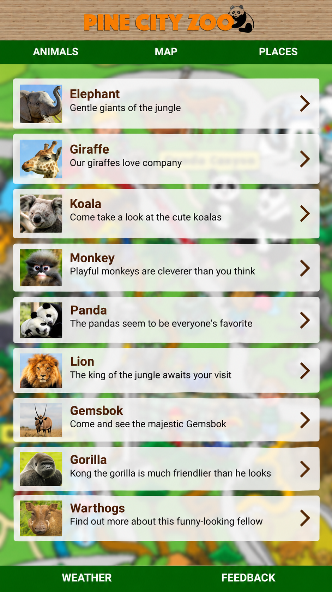
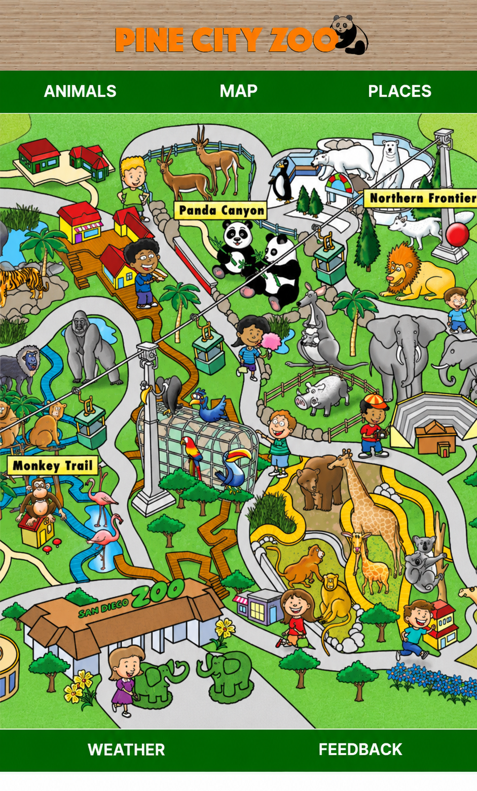
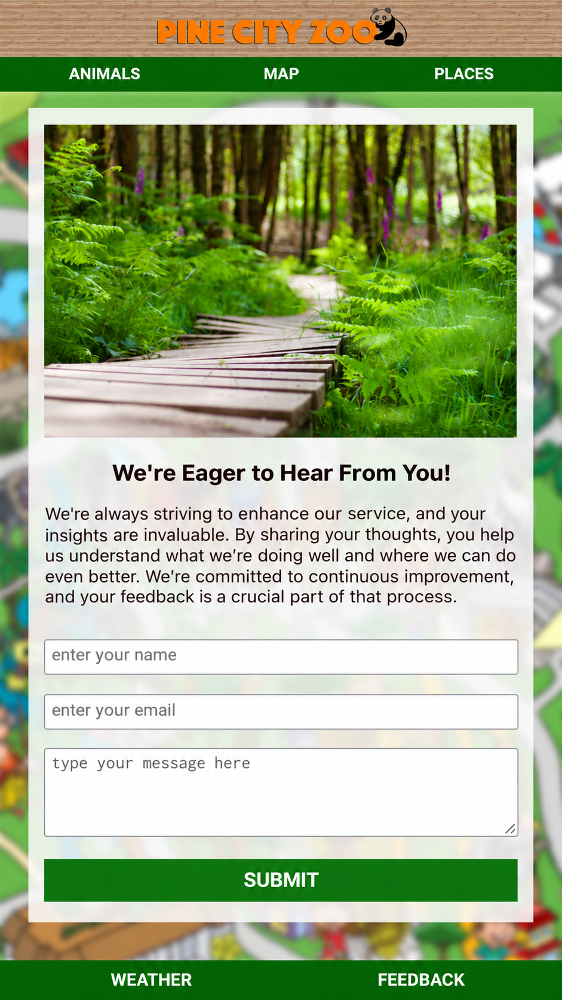
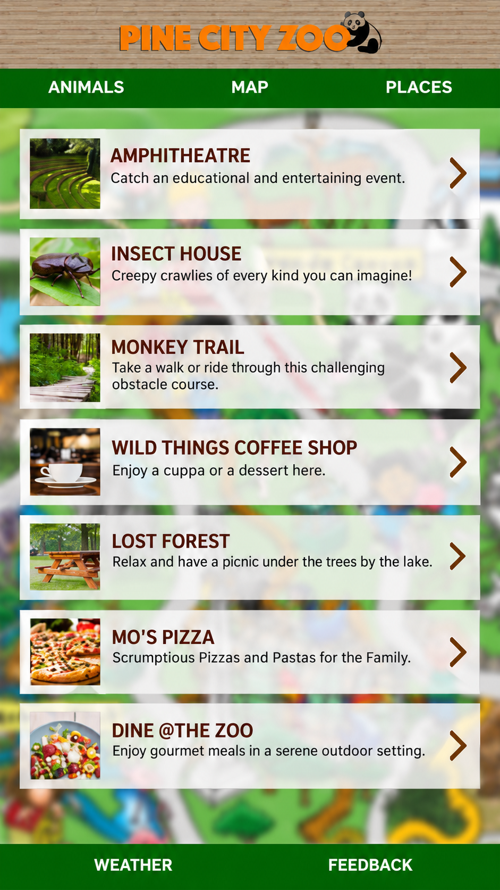
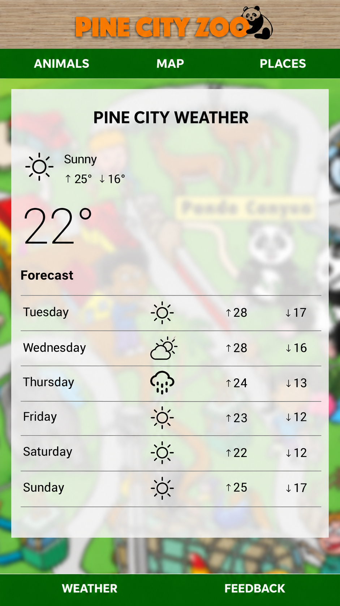

# Zoo App — Interactive Zoo Guide

A mobile-friendly zoo guide built with **HTML5 and CSS3**. Browse the zoo map, learn about animals, discover attractions and dining options, check the sample weather forecast, and leave feedback through a simple form interface.

## Live website

**[Open the Zoo App](https://codeswithbux.github.io/Zoo-App/)**

## Website preview

These five previews show the **Animals, Map, Places, Weather and Feedback** screens, with the browser bars and large blank areas removed. They are edited presentation images based on screenshots of the live app.

### Animals



### Map



### Places



### Weather



### Feedback



## Features

- **Zoo map:** Explore the illustrated zoo layout on the homepage and Map page.
- **Animals:** Browse animal profiles and open individual pages with photos and descriptions.
- **Places:** Discover attractions, eateries, and other destinations around the zoo.
- **Weather:** View a sample weather report and forecast (not live weather data).
- **Feedback:** Enter your details and a message; the current static form does not send or store submissions.
- **Navigation:** Move between Animals, Map, Places, Weather, and Feedback using fixed tabs.

## How to run locally

1. Download or clone the repository.
2. Open `index.html` in your browser.
3. Use the navigation tabs to explore the app.

No installation, server, or build tools are required.

## Project structure

```text
Zoo-App/
├── index.html          Homepage / zoo map
├── animals.html        Animal directory
├── places.html         Places directory
├── map.html            Zoo map
├── weather.html        Sample weather forecast
├── feedback.html       Feedback form
├── message.html        Thank-you page
├── lion.html           Example animal profile
├── elephant.html       Example animal profile
├── ...                 Other animal and attraction pages
├── style.css           Shared page styling
├── images/             Zoo images and five uniquely named README previews
└── README.md           Project information
```

## Navigation

```text
index.html (Zoo Map)
├── Animals → animal profiles
├── Map → zoo map
├── Places → attraction and dining pages
├── Weather → sample forecast
└── Feedback → thank-you page
```

## Technologies used

| Technology | Purpose |
|---|---|
| HTML5 | Website pages and content |
| CSS3 | Layout, colours, navigation and responsive styling |
| GitHub Pages | Static website deployment |

## Publishing with GitHub Pages

1. Ensure `index.html`, `style.css`, and the `images/` folder are in the repository root.
2. In the repository, go to **Settings → Pages**.
3. Under **Build and deployment**, select **Deploy from a branch**.
4. Choose the **main** branch and **/(root)**, then click **Save**.
5. Check the **Actions** tab for deployment errors and open the live link after a successful deployment.

## Notes

The weather forecast is demonstration content, and the feedback form does not connect to a backend service. The five preview images use unique `pine-city-zoo-readme-*.png` filenames. Place them inside your existing `images/` folder so the README can display them without replacing any current website images. These edited previews are separate from the original site images.
